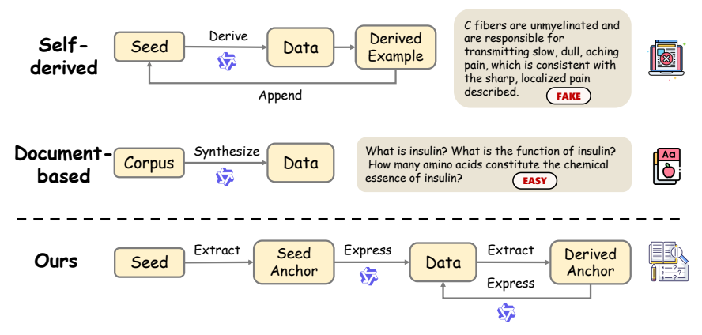
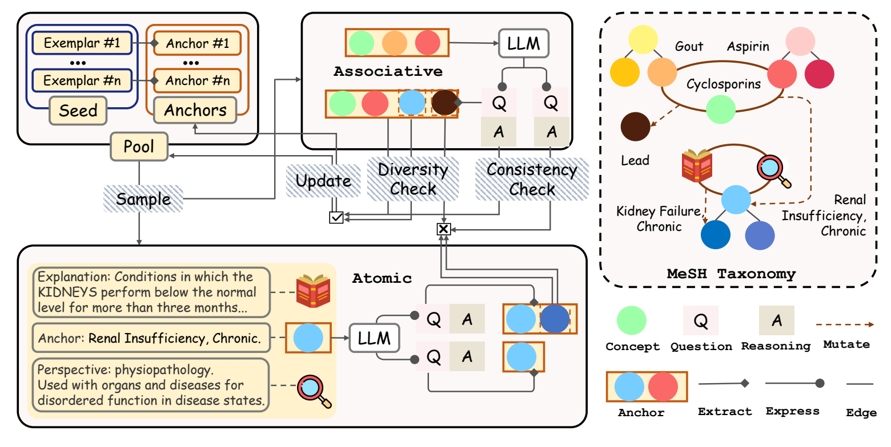
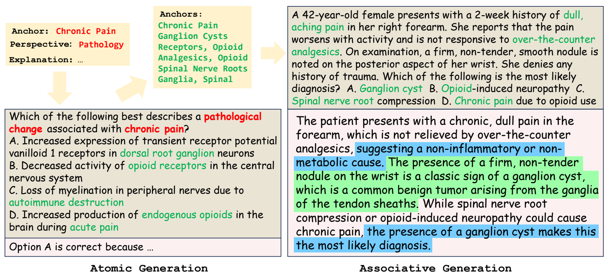

<div align="center">

<h1>SAGE</h1>
<h3>Semantic Anchor-Guided Evolution for<br>Grounded Medical QA Data Synthesis</h3>

<p>
Chuan Li<sup>1</sup>, Chengyu Wang<sup>2</sup>, Cen Chen<sup>1</sup>,<br>
Ye Lyu<sup>1</sup>, Mingyuan Fan<sup>1</sup>, Ming Gao<sup>1</sup>
</p>
<p><sup>1</sup> East China Normal University &nbsp; <sup>2</sup> Alibaba Group</p>

<p>
  
  <a href="https://huggingface.co/datasets/DIaac/SAGE-10K"></a>
</p>

<p><b>Grounded medical QA synthesis with small local models and MeSH semantic anchors.</b></p>

<p>
  <a href="https://huggingface.co/datasets/DIaac/SAGE-10K">Dataset</a> &nbsp; / &nbsp;
  <a href="#overview">Overview</a> &nbsp; / &nbsp;
  <a href="#results">Results</a> &nbsp; / &nbsp;
  <a href="#quick-start">Quick Start</a>
</p>
</div>

## Overview

**SAGE** turns a small seed set and a public medical taxonomy into reasoning-rich medical QA training data. It grounds synthesis in **Medical Subject Headings (MeSH)** and evolves the active semantic anchors across rounds, using a small, locally deployed language model without requiring a large document corpus or external generation APIs.

<p align="center">
  
</p>

*Figure 1. SAGE grounds generation in semantic anchors and evolves them through the synthesized questions.*

- **Atomic grounding:** individual concepts guide generation through MeSH definitions and clinical qualifiers.
- **Associative reasoning:** multiple concepts and few-shot examples guide generation of connected medical scenarios.
- **Iterative evolution:** answer-consistency checking selects candidates, expansion budgets control repetition, and newly surfaced concepts become anchors for subsequent rounds.

<details>
<summary><b>Full framework overview (Figure 2)</b></summary>

<p align="center">
  
</p>

*Figure 2. The MeSH taxonomy stays fixed; the active anchor configurations evolve.*

</details>

### From Concepts to Clinical Scenarios

Atomic generation grounds a question in a single concept. Concepts surfaced in the question then provide anchors for associative generation in subsequent rounds.

<p align="center">
  
</p>

*Figure 5. A concrete example of dual-track evolutionary synthesis.*

## Results

**SAGE reaches 68.12% average accuracy across five medical QA benchmarks with 10k synthesized examples.** Selected results from Table 1 of the paper are shown below. All rows fine-tune Qwen3-4B-Base; scores are accuracy (%).

| Method / Dataset | Scale | AVG | MedMCQA | MedQA | PubMedQA | MMLU-Pro (med) | GPQA (med) |
| --- | ---: | ---: | ---: | ---: | ---: | ---: | ---: |
| m23k | 23k | 67.39 | 64.19 | 76.20 | 76.00 | 68.79 | 51.79 |
| CoT-Self-Instruct | 10k | 63.71 | 62.08 | 67.40 | 70.00 | 61.89 | 57.18 |
| Wrap | 98k | 50.20 | 47.53 | 47.13 | 69.50 | 47.10 | 39.74 |
| **SAGE** | 10k | 68.12 | 64.98 | 70.07 | 80.80 | 63.19 | 61.54 |

## Quick Start

### Get the Data

The released dataset is available on [Hugging Face: DIaac/SAGE-10K](https://huggingface.co/datasets/DIaac/SAGE-10K). Each example includes a question with answer choices (`prompt`), reasoning and a final answer (`response`), and generation metadata. See the dataset card for the field descriptions.

Load it directly with `datasets`:

```python
from datasets import load_dataset

dataset = load_dataset("DIaac/SAGE-10K", split="train")
```

For the training launcher below, download the original JSONL file:

```python
from huggingface_hub import hf_hub_download

hf_hub_download(
    repo_id="DIaac/SAGE-10K",
    repo_type="dataset",
    filename="sage_gen_4b_10k.jsonl",
    local_dir="data_out",
)
```

### Run the Code

Generation, training, and evaluation use Linux with NVIDIA GPUs. Run the commands below from the repository root.

<details>
<summary><b>1. Install dependencies</b></summary>

```bash
python -m venv .venv
source .venv/bin/activate
pip install --upgrade pip
pip install torch==2.6.0 torchvision==0.21.0 torchaudio==2.6.0 \
  --index-url https://download.pytorch.org/whl/cu124
pip install -r requirements.txt
```

</details>

<details>
<summary><b>2. Generate new QA data with SAGE</b></summary>

Download the **2025 descriptor and qualifier XML files** from the [NLM MeSH archive](https://www.nlm.nih.gov/databases/download/mesh.html) to `data/desc2025.xml` and `data/qual2025.xml`, then convert them:

```bash
mkdir -p data data_out
python src/data_curation/xml2jsonl.py \
  data/desc2025.xml data/desc2025.jsonl --tag DescriptorRecord
python src/data_curation/xml2jsonl.py \
  data/qual2025.xml data/qual2025.jsonl --tag QualifierRecord
```

Prepare a seed JSONL file at `data/m1k_with_mesh_local.jsonl`. Each record needs `question` (including answer choices) and `mesh_terms_local` (matched MeSH descriptor names). The paper uses seed questions from [m1k-tokenized](https://huggingface.co/datasets/UCSC-VLAA/m1k-tokenized). 

```bash
python src/data_curation/sage_gen.py \
  --model_path Qwen/Qwen3-4B \
  --seed_file data/m1k_with_mesh_local.jsonl \
  --desc data/desc2025.jsonl \
  --qual data/qual2025.jsonl \
  --index data/mesh_indices.pkl \
  --output_file data_out/sage_gen.jsonl \
  --epochs 4 \
  --parallel_n 2 \
  --generation_batch_size 32 \
  --target_count 10000
```

The MeSH index is cached automatically. Accepted examples are appended to the output file, so use a fresh output path for each run. The target count is checked after each batch.

</details>

<details>
<summary><b>3. Fine-tune Qwen3-4B-Base</b></summary>

The following command uses the released dataset and the paper's training configuration: five epochs, a learning rate of `1e-5`, and a global batch size of 16.

```bash
bash exps/sft_ds.sh \
  --model_name Qwen/Qwen3-4B-Base \
  --train_dataset_name data_out/sage_gen_4b_10k.jsonl \
  --epochs 5 \
  --lr 1e-5 \
  --global_batch_size 16 \
  --per_device_batch_size 1 \
  --gpu_count 2 \
  --output_dir outputs \
  --exp_name sage
```

Adjust `--gpu_count` for your hardware. The launcher uses a 1% validation split and saves checkpoints under `outputs/sage/<run_name>/`.

</details>

<details>
<summary><b>4. Evaluate a checkpoint</b></summary>

Download [m1_eval_data.json](https://huggingface.co/datasets/UCSC-VLAA/m1_eval_data/blob/main/m1_eval_data.json) to `data/m1_eval_data.json`. The complete evaluation entry point is [inference.py](src/eval/inference.py), which handles server startup, inference, and scoring. Replace `path/to/checkpoint` with the saved model directory:

```bash
python src/eval/inference.py \
  -c exps/configs/base.yaml \
  -u "model_path=path/to/checkpoint,eval_data_path=data/m1_eval_data.json,output_dir=outputs/eval,exp_name=sage,tp=1,dp=1,max_new_tokens=8192,temperature=0.6,suffix_prompt='Return your final response within \\boxed{{}}.',overwrite=true"
```

This entry point starts an SGLang server, runs inference and scoring, and stops the server after a successful run. Predictions and per-benchmark accuracies (`metrics.json`) are saved under `outputs/eval/sage/version_<n>/`.

</details>

## Code Structure

| Directory | Contents |
| --- | --- |
| [`src/data_curation`](src/data_curation) | MeSH preparation, semantic mapping, and SAGE synthesis. |
| [`src/train`](src/train) | Supervised fine-tuning. |
| [`src/eval`](src/eval) | Inference, answer extraction, and scoring. |
| [`exps`](exps) | Launchers and configurations. |

## Acknowledgments

We thank the [U.S. National Library of Medicine](https://www.nlm.nih.gov/) for MeSH and the [m1 project](https://github.com/UCSC-VLAA/m1) for the seed questions and benchmark resources.
